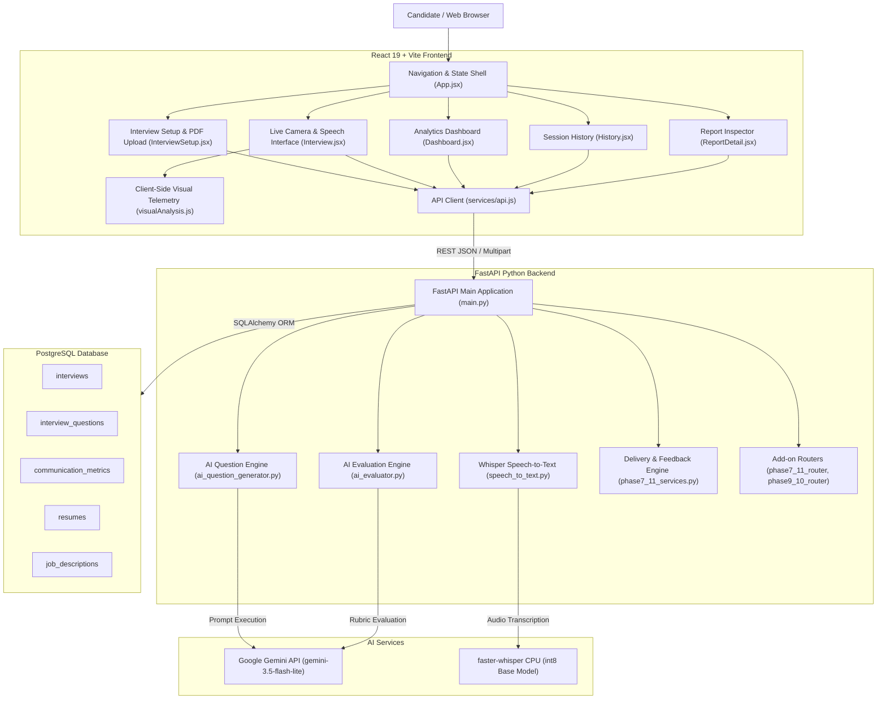

# System Architecture

---

## Architectural Highlights
- **Decoupled Architecture**: The React SPA frontend communicates with the FastAPI backend solely via clean RESTful APIs.
- **Client-Side Behavioral Telemetry**: Video frame sampling runs entirely client-side via HTML5 canvas heuristics (`visualAnalysis.js`), computing eye contact, head stability, and posture without transmitting video streams across the network.
- **Local Speech Processing**: Audio transcription runs locally using `faster-whisper` on CPU int8, eliminating cloud STT fees and ensuring zero third-party audio transmission.
- **Single-Transaction Persistence**: Each interview evaluation, along with its questions, metrics, and metadata, is committed in an atomic database transaction.
- **Additive Migrations**: Alembic manages all database migrations additively to guarantee existing candidate records and reference dimensions are preserved.
