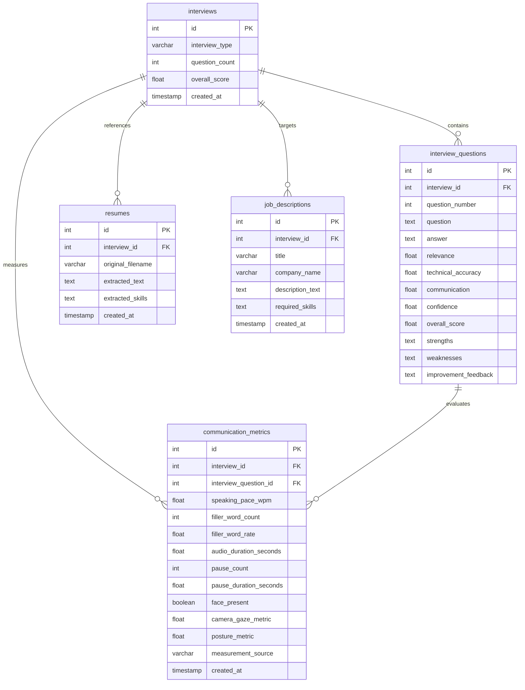

# Database Architecture & Schema Reference

The system uses **PostgreSQL** managed through **SQLAlchemy 2.0** ORM and **Alembic** migrations.

---

## 1. Entity-Relationship Diagram



---

## 2. Table Specifications

### `interviews`
Primary table tracking each completed or ongoing interview session.
- `id`: Auto-incrementing primary key.
- `interview_type`: `'technical'`, `'hr'`, or `'behavioral'`.
- `question_count`: Total number of questions assigned.
- `overall_score`: Aggregate mean score (0.0 to 10.0).
- `created_at`: Time of session completion.

### `interview_questions`
Stores individual question prompts, candidate transcripts, and AI-evaluated scores.
- `interview_id`: Foreign key with `ON DELETE CASCADE` to `interviews.id`.
- `strengths` & `weaknesses`: JSON-serialized string array for flexible reporting.
- `improvement_feedback`: Actionable guidance for the specific question.

### `communication_metrics`
Logs objective delivery signals computed from speech duration and regex transcript analysis.
- `speaking_pace_wpm`: Words per minute.
- `filler_word_count`: Number of detected hesitation words.
- `filler_word_rate`: Density percentage relative to total words spoken.
- `face_present`: Indicator of webcam engagement during answer.

### `resumes` & `job_descriptions`
Stores parsed metadata and skill sets extracted from user uploads.

---

## 3. Migration Strategy
All migrations reside in `backend/alembic/versions/`.
- Revision `9a664f23c784`: Initial tables (`interviews`, `interview_questions`).
- Revision `phase9_10_additive_001`: Additive migration (`communication_metrics`, `resumes`, `job_descriptions`).

To verify current database head:
```powershell
cd backend
alembic current
```
To apply pending additive migrations:
```powershell
alembic upgrade head
```
